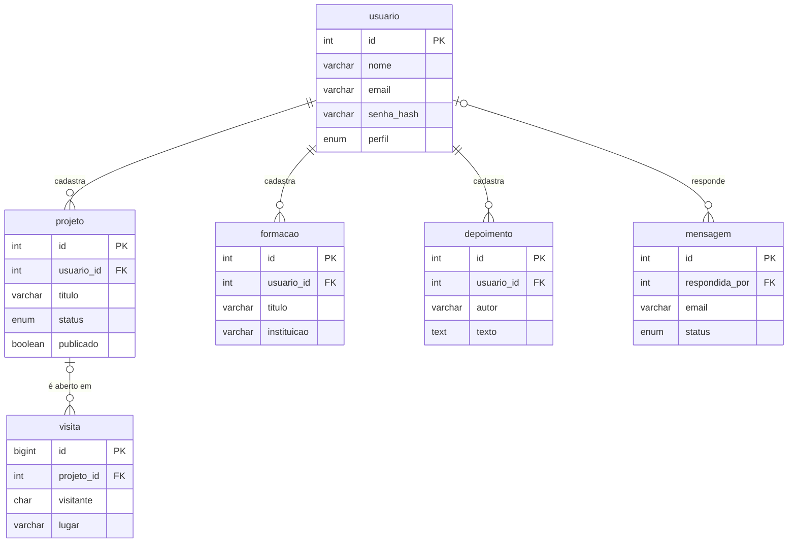

# Banco de dados do Mundo Swarttz (MySQL)

> **Status:** documentação (fase 1). Nenhum código do banco foi escrito ainda. Primeiro definimos **o que** o banco faz e **como** ele é desenhado; o código vem depois, seguindo este documento.

---

## 1. Visão

Hoje todo o conteúdo do site (projetos, formações, depoimentos, contatos) fica escrito à mão no arquivo `js/config.js`. Para mudar um projeto, é preciso editar código e publicar de novo.

Com o banco MySQL, o Mundo Swarttz passa a ter:

1. **Painel admin**: a Gabriella entra com e-mail e senha e cadastra, edita, publica ou esconde projetos, formações e depoimentos, sem mexer no código.
2. **Contador de visitas**: o site registra, sem identificar ninguém, quantas pessoas visitaram e quais lugares do mundo 3D foram mais abertos.
3. **Formulário de contato**: quem visita manda uma mensagem pelo site; ela fica guardada no banco e aparece no painel.

O mundo 3D continua funcionando mesmo se o servidor estiver fora do ar: nesse caso ele usa o `config.js` como reserva.

---

## 2. Requisitos

### Funcionais (o que o sistema faz)

| Código | Requisito |
|---|---|
| RF01 | A administradora entra no painel com e-mail e senha. |
| RF02 | No painel, é possível criar, editar, publicar/despublicar e reordenar **projetos**. |
| RF03 | No painel, é possível criar, editar, publicar/despublicar e reordenar **formações**. |
| RF04 | No painel, é possível criar, editar, publicar/despublicar e reordenar **depoimentos**. |
| RF05 | O mundo 3D e a versão simples mostram só o conteúdo **publicado** vindo do banco. |
| RF06 | Cada lugar aberto no mundo 3D (cinema, biblioteca, cartas…) gera um registro de visita. |
| RF07 | O painel mostra visitas por dia, visitantes únicos, lugares e projetos mais abertos, e celular × computador. |
| RF08 | O visitante envia uma mensagem pelo formulário de contato (nome, e-mail, assunto, mensagem). |
| RF09 | No painel, as mensagens aparecem como **nova**, **lida** ou **respondida**, com quem respondeu. |
| RF10 | A administradora pode cadastrar outras pessoas com perfil **editor**. |

### Não funcionais (como o sistema deve ser)

| Código | Requisito |
|---|---|
| RNF01 | **Privacidade (LGPD):** o contador de visitas não guarda IP, nome nem e-mail. O visitante é um código aleatório criado no navegador. |
| RNF02 | Senhas são guardadas só como **hash** (bcrypt), nunca em texto. |
| RNF03 | O formulário de contato tem proteção contra robôs (campo-armadilha e limite de envios por minuto). |
| RNF04 | O site continua abrindo mesmo com o servidor ou o banco fora do ar (usa o `config.js` como reserva). |
| RNF05 | A senha do banco nunca vai para o GitHub: fica em variáveis de ambiente do servidor. |
| RNF06 | Hospedagem com custo zero ou baixo. |

---

## 3. Arquitetura

```
 Navegador ──► GitHub Pages (site: index.html, simples.html, admin.html)
     │
     └──► API (Node.js + Express) ──► MySQL
          rotas /api/...            (tabelas da seção 4)
```

- **Site:** continua no GitHub Pages. Ganha uma página nova, `admin.html` (o painel).
- **API:** um servidor pequeno que é o **único** que conversa com o banco. O navegador nunca acessa o MySQL direto, porque isso exporia a senha do banco.
- **MySQL:** guarda as 6 tabelas abaixo.

---

## 4. Tabelas

O diagrama mostra as tabelas e as ligações. `PK` é a **chave primária** (o `id` que identifica cada linha). `FK` é a **chave estrangeira** (uma coluna que guarda o `id` de outra tabela e cria a ligação).



### 4.1 `usuario` — quem entra no painel

| Coluna | Tipo | Regra | Para que serve |
|---|---|---|---|
| id | INT | PK, auto incremento | identifica a pessoa |
| nome | VARCHAR(80) | obrigatório | nome mostrado no painel |
| email | VARCHAR(120) | obrigatório, único | login |
| senha_hash | VARCHAR(255) | obrigatório | senha embaralhada (bcrypt) |
| perfil | ENUM('admin','editor') | padrão 'editor' | o que a pessoa pode fazer (seção 5) |
| ativo | BOOLEAN | padrão TRUE | desativar sem apagar |
| criado_em | DATETIME | padrão agora | auditoria |

### 4.2 `projeto` — os filmes do cinema

| Coluna | Tipo | Regra | Para que serve |
|---|---|---|---|
| id | INT | PK | identifica o projeto |
| usuario_id | INT | **FK → usuario.id** | quem cadastrou |
| titulo | VARCHAR(100) | obrigatório | nome do projeto |
| slug | VARCHAR(60) | único | endereço curto (ex.: `pixelinha`) |
| descricao | TEXT | | texto do cartaz |
| status | ENUM('em cartaz','em produção','lançamento previsto') | obrigatório | etiqueta do filme |
| tecnologias | VARCHAR(255) | | lista separada por vírgula |
| url | VARCHAR(255) | | site no ar |
| repo | VARCHAR(255) | | repositório no GitHub |
| ordem | INT | padrão 0 | posição na bilheteria |
| publicado | BOOLEAN | padrão FALSE | aparece no site ou não |
| atualizado_em | DATETIME | atualiza sozinho | auditoria |

### 4.3 `formacao` — os livros da biblioteca

| Coluna | Tipo | Regra | Para que serve |
|---|---|---|---|
| id | INT | PK | identifica a formação |
| usuario_id | INT | **FK → usuario.id** | quem cadastrou |
| titulo | VARCHAR(120) | obrigatório | nome do curso |
| instituicao | VARCHAR(100) | obrigatório | escola, faculdade, plataforma |
| tipo | VARCHAR(40) | | curso técnico, graduação, carreira… |
| situacao | VARCHAR(40) | | cursando, concluído, trancado… |
| ordem | INT | padrão 0 | posição na estante |
| publicado | BOOLEAN | padrão FALSE | aparece no site ou não |

### 4.4 `depoimento` — as cartas

| Coluna | Tipo | Regra | Para que serve |
|---|---|---|---|
| id | INT | PK | identifica o depoimento |
| usuario_id | INT | **FK → usuario.id** | quem cadastrou no painel |
| autor | VARCHAR(80) | obrigatório | quem escreveu a carta |
| relacao | VARCHAR(120) | | ex.: "Colega de curso técnico" |
| texto | TEXT | obrigatório | a carta |
| foto | VARCHAR(255) | | caminho da foto |
| ordem | INT | padrão 0 | posição no carrossel |
| publicado | BOOLEAN | padrão FALSE | aparece no site ou não |

### 4.5 `mensagem` — formulário de contato

| Coluna | Tipo | Regra | Para que serve |
|---|---|---|---|
| id | INT | PK | identifica a mensagem |
| nome | VARCHAR(80) | obrigatório | quem mandou |
| email | VARCHAR(120) | obrigatório | para responder |
| assunto | VARCHAR(120) | | |
| texto | TEXT | obrigatório | a mensagem |
| status | ENUM('nova','lida','respondida') | padrão 'nova' | controle no painel |
| respondida_por | INT | **FK → usuario.id**, pode ficar vazio | quem respondeu |
| criada_em | DATETIME | padrão agora | quando chegou |

### 4.6 `visita` — contador de visitas

Cada linha é **um lugar aberto** por um visitante. "Visitantes únicos" = quantos `visitante` diferentes existem.

| Coluna | Tipo | Regra | Para que serve |
|---|---|---|---|
| id | BIGINT | PK | identifica o registro |
| visitante | CHAR(36) | obrigatório | código aleatório do navegador (não identifica a pessoa) |
| lugar | VARCHAR(20) | obrigatório | `chegada`, `cinema`, `biblioteca`, `cartas`, `telefone`, `sobre`… |
| projeto_id | INT | **FK → projeto.id**, pode ficar vazio | qual filme foi aberto no cinema |
| dispositivo | ENUM('celular','computador','tablet') | | tipo de tela |
| criada_em | DATETIME | padrão agora | quando |

---

## 5. Perfis de acesso

| Perfil | O que vê | O que pode fazer | O que é restrito |
|---|---|---|---|
| **admin** (Gabriella) | Tudo: conteúdo publicado e rascunhos, mensagens com e-mail, contador de visitas, usuários | Criar, editar, publicar e apagar projetos, formações e depoimentos; marcar e responder mensagens; cadastrar e desativar editores | Nada no sistema; a senha das pessoas nunca aparece, nem para ela |
| **editor** (alguém que ajuda) | Projetos, formações e depoimentos (publicados e rascunhos) e o contador de visitas | Criar e editar conteúdo e salvar como rascunho | Publicar ou apagar; ver mensagens de contato (têm dados pessoais); gerenciar usuários |
| **visitante** (público, sem login) | Só o conteúdo publicado, no mundo 3D e na versão simples | Enviar mensagem pelo formulário; gerar registros de visita sem perceber | Painel, rascunhos, mensagens, contador, qualquer edição |

---

## 6. Modelo para a atividade do Excel

A atividade pede de 3 a 4 entidades. Use **4 das tabelas acima**, uma por aba, com os mesmos nomes de coluna, mais a aba **Perfis** (seção 5). Assim o Excel é exatamente o desenho do banco real.

**Aba `usuario`**

| id | nome | email | perfil |
|---|---|---|---|
| 1 | Gabriella Swarttz | gabriellaswarttz@gmail.com | admin |
| 2 | Ana Lima | ana@exemplo.com | editor |
| 3 | Bruno Reis | bruno@exemplo.com | editor |

**Aba `projeto`** (`usuario_id` → usuario)

| id | usuario_id | titulo | status | publicado |
|---|---|---|---|---|
| 1 | 1 | Mundo Swarttz | em cartaz | sim |
| 2 | 1 | PixeLinha | em cartaz | sim |
| 3 | 2 | JC Resolve | em produção | não |

**Aba `mensagem`** (`respondida_por` → usuario)

| id | nome | email | status | respondida_por |
|---|---|---|---|---|
| 1 | Carla Dias | carla@exemplo.com | respondida | 1 |
| 2 | Diego Melo | diego@exemplo.com | lida | |
| 3 | Elisa Rocha | elisa@exemplo.com | nova | |

**Aba `visita`** (`projeto_id` → projeto)

| id | visitante | lugar | projeto_id | dispositivo |
|---|---|---|---|---|
| 1 | a1b2c3 | chegada | | celular |
| 2 | a1b2c3 | cinema | 2 | celular |
| 3 | f9e8d7 | cinema | 1 | computador |

Os e-mails `@exemplo.com` são inventados de propósito, para não expor o contato real de ninguém.

---

## 7. Decisões pendentes

| Decisão | Opções | Observação |
|---|---|---|
| Onde roda o MySQL | **TiDB Cloud Starter** (grátis, compatível com MySQL) ou **Aiven MySQL Developer** (MySQL puro, cerca de US$ 5/mês) | O plano grátis de MySQL da Aiven foi encerrado para novos bancos. |
| Onde roda a API | **Render** (grátis) ou outro serviço com plano grátis | No Render grátis, o servidor "dorme" após 15 min sem uso e leva cerca de 1 min para acordar. O mundo 3D não trava, porque usa o `config.js` enquanto isso. |

---

## 8. Próximas fases

1. **Fase 1 (este documento):** visão, requisitos, tabelas e perfis.
2. **Fase 2:** criar as contas de hospedagem, as tabelas (`schema.sql`) e a API com as rotas.
3. **Fase 3:** painel admin (`admin.html`) e formulário de contato.
4. **Fase 4:** o mundo 3D e a versão simples passam a ler o conteúdo da API, e o contador começa a registrar.
